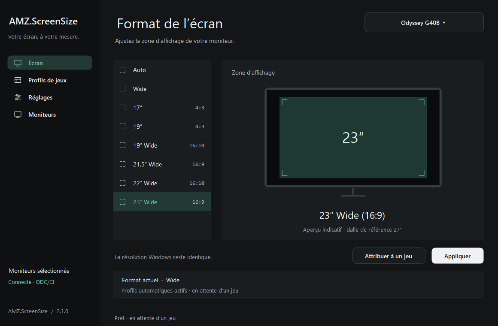
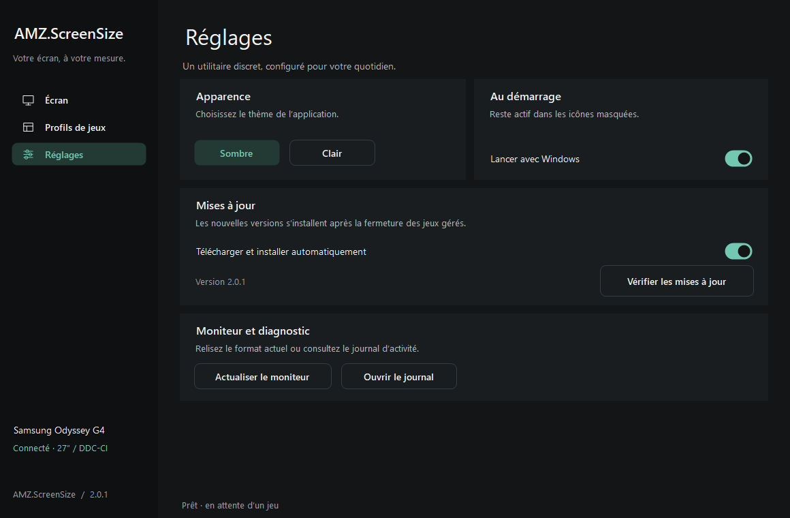
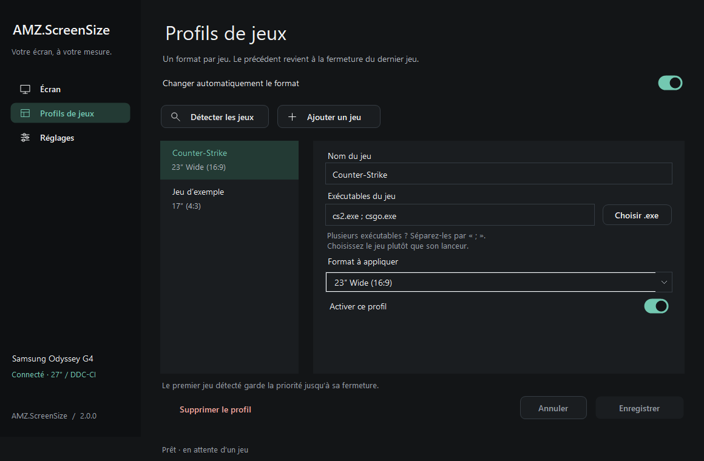
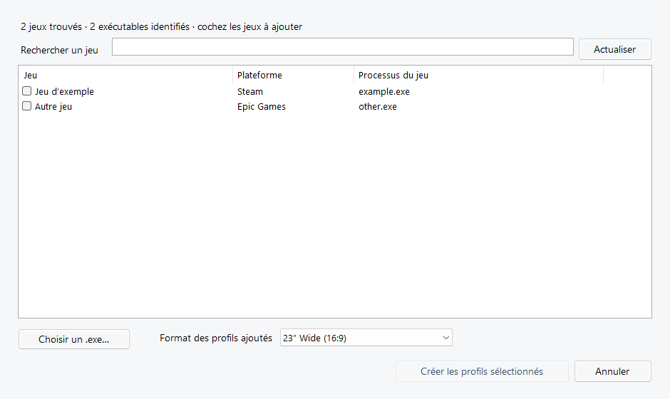

# AMZ.ScreenSize

Choisir le format d’image des moniteurs HDMI ou DisplayPort compatibles depuis Windows et appliquer automatiquement un format différent pour chaque jeu.

Une application Windows portable, avec une interface en français, un thème sombre par défaut et une icône dans la zone de notification. Quatre espaces : **Écran**, **Profils de jeux**, **Réglages** et **Moniteurs**.



## Télécharger

Télécharger **[AMZ.ScreenSize.exe dans la dernière release](https://github.com/4MZ31/AMZ.ScreenSize/releases/latest)**, ou l’archive ZIP qui contient aussi la documentation. Le dépôt et les releases sont publics.

L’exécutable est autonome : aucun script PowerShell ni fichier source n’est nécessaire pour l’utiliser. Il s’appuie sur .NET Framework installé dans Windows.

**Configuration :** Windows 10/11 64 bits avec .NET Framework 4.8 ou supérieur. La configuration vérifiée est un Samsung Odyssey G4 **S27BG400EU / SAM727E**, connecté en **DisplayPort**, avec une AMD Radeon RX 7800 XT. Le G27F et le MAG272CQR ont également été détectés en HDMI et interrogés en lecture seule. Leur commande de redimensionnement n’a pas été identifiée.

## Utiliser l’application

1. Ouvrir `AMZ.ScreenSize.exe`.
2. Dans **Écran**, ouvrir le sélecteur, cocher les moniteurs souhaités et valider. Choisir ensuite un format commun dans la liste.
3. Cliquer sur **Appliquer** pour l’utiliser immédiatement, ou sur **Attribuer à un jeu** pour enregistrer ce format dans un profil.
4. Ouvrir **Profils de jeux** pour configurer les jeux et activer **Changer automatiquement le format**.

### Détection HDMI et DisplayPort

À l’ouverture et lors d’un changement de branchement, la détection identifie le connecteur de chaque trajet vidéo actif avec [QueryDisplayConfig](https://learn.microsoft.com/en-us/windows/win32/api/winuser/nf-winuser-querydisplayconfig). Seuls les trajets HDMI et DisplayPort externes associés à un moniteur physique unique sont interrogés par DDC/CI.

Un modèle inconnu entre dans le sélecteur si sa réponse MCCS annonce plusieurs valeurs de mise à l’échelle standard reconnues pour la commande 0x86 et si sa valeur actuelle correspond. Les variantes documentées SAM727E, SAM7476, SAM06A3 et ACI28A7 ont leur propre correspondance. Sur ACR0692, 0x86 désigne la netteté. Les appareils indéterminés figurent uniquement dans **Moniteurs**. Une déclaration du constructeur peut être incomplète ou erronée. Chaque application de format est vérifiée par relecture. [Base ddccontrol-db](https://github.com/ddccontrol/ddccontrol-db/tree/master/db/monitor) · [Limites des capacités DDC](https://www.ddcutil.com/command_capabilities/).

### Apparence et réglages

Dans **Réglages → Apparence**, choisir **Sombre** ou **Clair**. Le changement s’applique immédiatement à l’interface et aux menus de notification ; le choix est conservé au prochain lancement. Le thème sombre s’applique aussi par défaut lors de la migration d’une ancienne version.



Le lancement avec Windows, les mises à jour et le journal sont regroupés sur cette page. [Voir le thème clair](docs/interface-light.png).

Avec un G4 sélectionné seul, les huit préréglages suivants sont disponibles :

- **Auto** — conserve le format de la source.
- **Wide** — utilise toute la surface de l’écran.
- **17″ (4:3)**.
- **19″ (4:3)**.
- **19″ Wide (16:10)**.
- **21,5″ Wide (16:9)**.
- **22″ Wide (16:10)**.
- **23″ Wide (16:9)**.

Il s’agit des réglages **Taille de l’écran / Screen Size** du moniteur. L’application ne change pas la définition Windows, par exemple 1920 × 1080, ni la résolution choisie dans le jeu. L’aperçu est indicatif : le signal vidéo et les options du moniteur influencent le rendu.

### Créer des profils par jeu

Ouvrir **Profils de jeux** dans la navigation. Chaque profil possède un nom, un ou plusieurs exécutables, un format et une activation indépendante. La liste et l’éditeur sont réunis sur la même page.



Cliquer sur **Ajouter un jeu**, saisir son nom et choisir son `.exe`, ou indiquer les noms de processus séparés par `;` ou une virgule. Par exemple `game.exe ; game-win64.exe`. Choisir le format souhaité puis **Enregistrer**. **Annuler** rétablit les derniers profils enregistrés. Les brouillons restent présents en changeant de page ; une erreur de validation est affichée dans l’éditeur. L’installation d’une mise à jour attend la fin de ces modifications.

Le processus choisi doit être celui du jeu qui reste ouvert pendant la partie, pas celui du lanceur Steam ou Epic. La comparaison ignore la casse et accepte les noms avec ou sans `.exe`. Un même processus ne peut pas appartenir à plusieurs profils : les jeux partageant exactement le même nom d’exécutable doivent utiliser un profil commun ou être configurés manuellement.

Les préférences de la version 1.0 sont reprises automatiquement dans un profil **Counter-Strike** pour `cs2.exe` et `csgo.exe`, avec le format précédemment enregistré. La liste accepte jusqu’à 64 profils et 16 noms de processus par profil.

### Détecter les jeux installés

La recherche démarre automatiquement à l’ouverture de la page des profils. Les jeux installés et les profils existants sont réunis dans la liste de gauche, avec une recherche par nom, plateforme ou exécutable. **Actualiser** relance la détection. Aucune fenêtre de sélection supplémentaire ne s’ouvre.



Sélectionner un jeu sans profil, choisir son format à droite et cliquer sur **Créer le profil**. Pour plusieurs jeux, cocher leurs lignes, choisir un format commun puis cliquer sur **Créer n profils**. Les coches sont conservées pendant une recherche. Les profils existants sont signalés par une coche simple et restent modifiables directement dans la même page. Aucun profil n’est créé par une simple sélection.

La détection lit les sources locales suivantes, sans connexion aux comptes des lanceurs et sans parcours complet des disques :

- **Steam** : manifestes des jeux et bibliothèques secondaires, y compris sur d’autres disques.
- **Epic Games** : manifestes des installations du lanceur.
- **GOG** : informations d’installation du registre Windows.
- **Xbox / Microsoft Store** : installations accessibles dans les dossiers `XboxGames` et leurs fichiers `MicrosoftGame.config`.
- Certaines autres installations déclarées dans Windows par des éditeurs de jeux connus.

L’exécutable est proposé à partir du manifeste et d’une recherche limitée au dossier du jeu. Les outils de désinstallation, de mise à jour, de rapport de plantage et les anti-triches sont filtrés. Cette identification reste indicative : si l’exécutable est absent ou incorrect, sélectionner le jeu et utiliser **Choisir un .exe…**, ou créer le profil manuellement. Les jeux protégés ou les installations non déclarées peuvent ne pas être détectés. La liste des jeux reste sur le PC ; elle n’est pas envoyée à GitHub.

### Détection des processus et restauration

L’application vérifie les processus toutes les deux secondes. Elle mémorise le format courant **avant** d’appliquer le premier profil actif.

Si un seul jeu est ouvert, son format précédent revient à sa fermeture. Si plusieurs jeux sont ouverts, le premier détecté garde la priorité. Quand il se ferme, le jeu encore ouvert suivant reçoit son propre format ; le format d’origine revient après le dernier jeu géré. Si plusieurs jeux sont déjà ouverts au lancement de l’application, l’ordre des profils les départage.

Désactiver l’automatisme ou utiliser **Quitter et restaurer l’écran** restaure aussi le format d’origine. Modifier le format d’un profil actif l’applique immédiatement, sans remplacer le format d’origine à restaurer. Désactiver ou supprimer le profil actif passe au jeu suivant ou restaure le format d’origine s’il n’en reste aucun.

Pendant une partie gérée automatiquement, l’application manuelle est désactivée. Désactiver l’automatisme permet de reprendre le contrôle manuel.

Les informations de restauration sont sauvegardées sur disque avant tout changement. Une interruption du programme peut ainsi être récupérée au lancement suivant. Si le moniteur est débranché ou en veille, l’application réessaie après dix secondes.

### Zone de notification

Fermer ou réduire la fenêtre conserve l’application en arrière-plan. Utiliser l’icône d’écran dans la zone de notification, accessible via la flèche **^** si elle est masquée :

- **Double-clic :** rouvrir l’interface.
- **Clic droit :** activer/désactiver l’automatisme, gérer les profils, changer leurs formats ou quitter proprement.
- **Icône verte :** automatisme actif ; **icône grise :** désactivé.

Cocher **Lancer avec Windows** dans **Réglages** pour démarrer en arrière-plan avec la session. Conserver l’exécutable à son emplacement après avoir activé cette option ; la décocher puis la recocher actualise le chemin si le fichier a été déplacé.

### Mises à jour automatiques

L’option **Télécharger et installer automatiquement** est activée par défaut dans **Réglages → Mises à jour**. L’application consulte la dernière release stable de ce dépôt après son lancement, puis au plus une fois par jour. Le bouton **Vérifier les mises à jour** permet de lancer une recherche manuelle.

Lorsqu’une version plus récente existe, l’application télécharge l’EXE et son fichier `SHA256SUMS.txt` en HTTPS depuis les releases de `4MZ31/AMZ.ScreenSize`. Elle vérifie l’empreinte SHA-256, le nom de l’assembly et sa version avant toute installation. Les préversions, les versions anciennes et les fichiers dont la vérification échoue sont refusés.

L’installation automatique attend que les jeux des profils soient fermés, que le format d’origine ait été restauré et que l’édition ou la sélection de profils soit terminée. Un assistant local remplace alors l’EXE et relance l’application, avec les mêmes préférences et le même état de fenêtre. Si les mises à jour automatiques sont désactivées, une mise à jour téléchargée peut être installée avec **Installer la mise à jour**.

L’ancien EXE est conservé à côté du nouveau sous le nom `AMZ.ScreenSize.exe.previous`. Un remplacement qui échoue conserve l’exécutable en place et n’est pas retenté automatiquement pendant une heure, pour éviter une boucle de redémarrages. Le journal indique le résultat. Le dossier de l’exécutable doit être accessible en écriture sans élévation ; un dossier utilisateur convient.

Les empreintes détectent un téléchargement altéré ; elles ne remplacent pas une signature numérique de l’éditeur. La confiance repose sur ce dépôt GitHub et sur HTTPS.

## Compatibilité et diagnostic

Chaque moniteur sélectionné est identifié par son chemin de périphérique Windows. Une configuration antérieure est associée automatiquement au G4 seulement s’il est identifiable sans ambiguïté. Après un changement de port, vérifiez la sélection.

Les huit codes ont été appliqués et relus sur le S27BG400EU de test. Le mode initial a été restauré après les essais. Un aller-retour automatique avec un processus de test a également été vérifié.

Le réglage peut être indisponible selon le signal, le mode PC/AV et les options **Adaptive-Sync / FreeSync Premium** ou **Ultrawide Game View**. Si le moniteur refuse un changement, vérifier d’abord sa disponibilité dans le menu physique de l’écran. Aucune autre option du moniteur n’est modifiée automatiquement.

Les préférences et le journal local sont enregistrés ici :

```text
%LOCALAPPDATA%\AMZ.ScreenSize\settings.json
%LOCALAPPDATA%\AMZ.ScreenSize\activity.log
```

Le bouton **Ouvrir le journal**, dans **Réglages**, ouvre le journal local. L’application ne collecte ni ne transmet de télémétrie et n’injecte aucun code dans le jeu. L’accès réseau est limité aux recherches et téléchargements de mises à jour GitHub ; le contrôle du moniteur fonctionne hors ligne.

Le diagnostic multi-écrans inventorie les moniteurs actifs, enregistre leurs capacités DDC/CI et lit la commande de mise à l’échelle `0x86`. Pour le modèle `SAM727E`, il lit aussi la commande Samsung connue. Le rapport distingue une lecture réussie, une commande seulement annoncée et un résultat indéterminé. Une lecture seule ne valide ni les valeurs à écrire ni la restauration d’un mode. La page **Écran** propose les appareils identifiés dans un menu à cases à cocher. Valider la sélection affiche les formats communs. Le logiciel traduit le format en code propre à chaque modèle et enregistre séparément la valeur initiale de chaque écran avant de l’appliquer. La sélection et les restaurations en attente sont conservées au redémarrage.

```powershell
# Exporter le format actuel, sans le modifier.
.\AMZ.ScreenSize.exe --diagnostic "$env:TEMP\screen-size.json"

# Inventorier tous les écrans actifs, sans modifier leurs réglages.
.\AMZ.ScreenSize.exe --scan-monitors "$env:TEMP\moniteurs.json"

# Demander la fermeture de l’instance existante avec restauration.
.\AMZ.ScreenSize.exe --quit
```

L’exécutable de cette version n’est pas signé numériquement. Les empreintes SHA-256 des fichiers distribués sont fournies dans `SHA256SUMS.txt` avec chaque release.

## Compiler et tester

Le projet utilise **C# et Windows Forms**, sans dépendance NuGet. Le script de compilation utilise le compilateur .NET Framework présent sous Windows 64 bits.

```powershell
git clone https://github.com/4MZ31/AMZ.ScreenSize.git
cd AMZ.ScreenSize
powershell.exe -NoProfile -ExecutionPolicy Bypass -File .\build.ps1 -Test -Package
```

- Exécutable : `bin\Release\AMZ.ScreenSize.exe`.
- Tests : `bin\Release\AMZ.ScreenSize.Tests.exe`.
- Fichiers distribuables : `dist\`.

Les **130 assertions hors matériel** comprennent 126 vérifications de logique, persistance, profils, détection, interface et validation des mises à jour, ainsi que quatre tests isolés du remplacement réel d’un EXE, de sa sauvegarde, de son redémarrage et du rejet d’un fichier invalide. Elles couvrent aussi les deux thèmes, les contrastes, la peinture complète des boutons et interrupteurs, la hauteur de navigation, l’absence de chevauchement au démarrage et dans les profils à taille minimale, les brouillons et la création intégrée de profils, à l’unité ou en groupe. Les workflows GitHub exécutent ces tests sans écran physique et sans modifier une installation utilisateur.

Pour lancer volontairement le test matériel sur un G4 compatible, hors partie :

```powershell
# L’écran changera brièvement de format. Le mode initial est restauré à la fin.
.\bin\Release\AMZ.ScreenSize.Tests.exe --hardware
```

Ce test ajoute **huit assertions** de relecture, une par préréglage. Ne pas le lancer en même temps qu’un autre utilitaire de contrôle du moniteur.

Un test matériel supplémentaire vérifie deux processus de jeux temporaires, la priorité du premier, le passage au format du second puis la restauration. Quitter d’abord toute instance de l’application :

```powershell
.\tests\Test-HardwareProfiles.ps1 -Executable .\bin\Release\AMZ.ScreenSize.exe -ScratchDirectory .\TestResults
```

### Organisation des sources

- `src/AMZ.ScreenSize/` : interface, contrôle du moniteur, automatisme et préférences.
- `tests/Tests.cs` : tests de cycle de vie, de persistance et tests matériels explicites.
- `build.ps1` : compilation, tests et création des archives et empreintes.
- `tools/New-AppIcon.ps1` : génération de l’icône du projet.
- `.github/workflows/` : intégration continue et publication des releases.

### Créer une release

1. Mettre à jour `VERSION`, `CHANGELOG.md` et les notes dans `docs/releases/`.
2. Vérifier `build.ps1 -Test -Package`.
3. Pousser un tag correspondant au fichier `VERSION`, par exemple `v1.0.1`.

Le workflow de release recompile et teste le projet sous Windows, puis publie l’exécutable, le ZIP et `SHA256SUMS.txt`. Les mises à jour automatiques utilisent uniquement les releases stables publiées.

## Protocole et sources

La taille d’image est lue et écrite via l’API Windows de configuration des moniteurs et le code VCP **`0xDB`**, absent de la chaîne de capacités annoncée par le G4. Le code standard `0x86` ne fonctionne pas sur l’exemplaire testé.

La correspondance utilisée est `0=Auto`, `1=Wide`, `2=17″ 4:3`, `3=19″ 4:3`, `4=19″ 16:10`, `5=21,5″ 16:9`, `6=22″ 16:10`, `7=23″ 16:9`. Les valeurs 8 et 9 présentes sur certains autres Odyssey ne sont pas proposées sur ce modèle.

- [Samsung : assistance et manuel du S27BG400EU](https://www.samsung.com/fr/support/model/LS27BG400EUXEN/).
- [Microsoft : lecture des paramètres VCP](https://learn.microsoft.com/en-us/windows/win32/api/lowlevelmonitorconfigurationapi/nf-lowlevelmonitorconfigurationapi-getvcpfeatureandvcpfeaturereply).
- [ddccontrol-db : correspondance Screen Size des Samsung Odyssey](https://github.com/ddccontrol/ddccontrol-db/blob/master/db/monitor/SAM7476.xml), utilisée comme point de départ puis vérifiée par écriture/relecture sur le G4.

## Licence

[MIT](LICENSE) — © 2026 4MZ31. Projet indépendant, sans affiliation avec Samsung ou Valve.

La refonte de l’interface suit la méthodologie [Unslop](https://github.com/heydamir/unslop) de **Damir Sokolovsky (@heydamir)**, sous [CC BY 4.0](https://creativecommons.org/licenses/by/4.0/). [Audit, direction et compte rendu des neuf passes](docs/ux-redesign.md). Les composants Windows Forms et les pictogrammes du projet sont réalisés localement.
